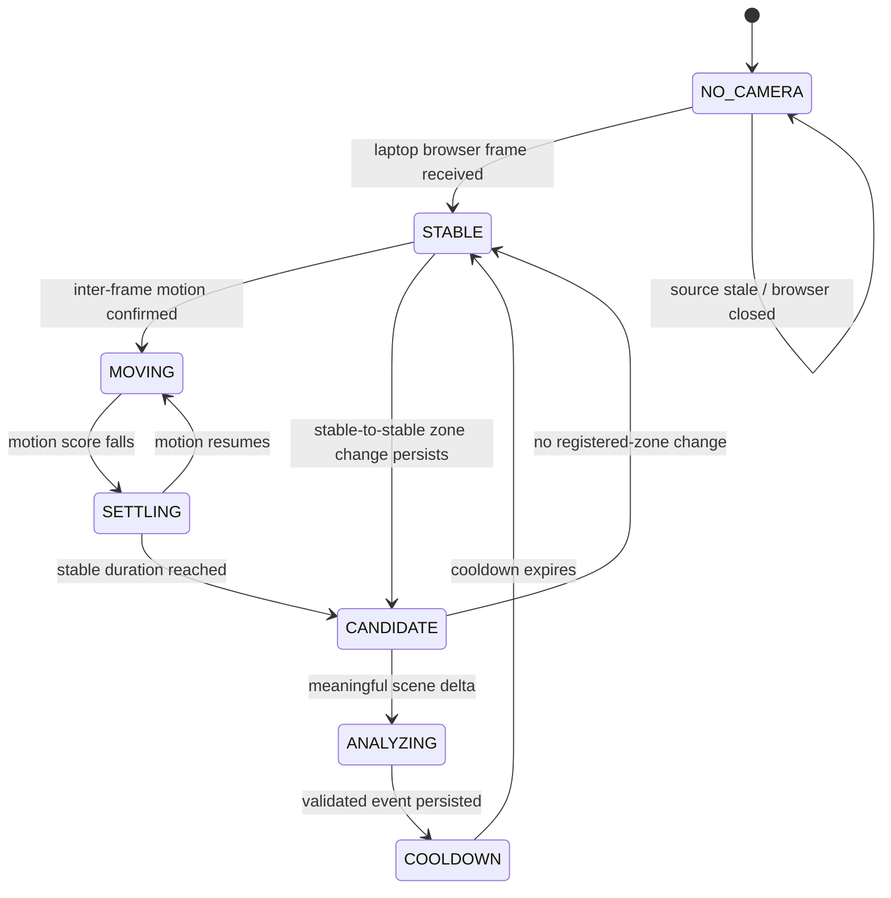
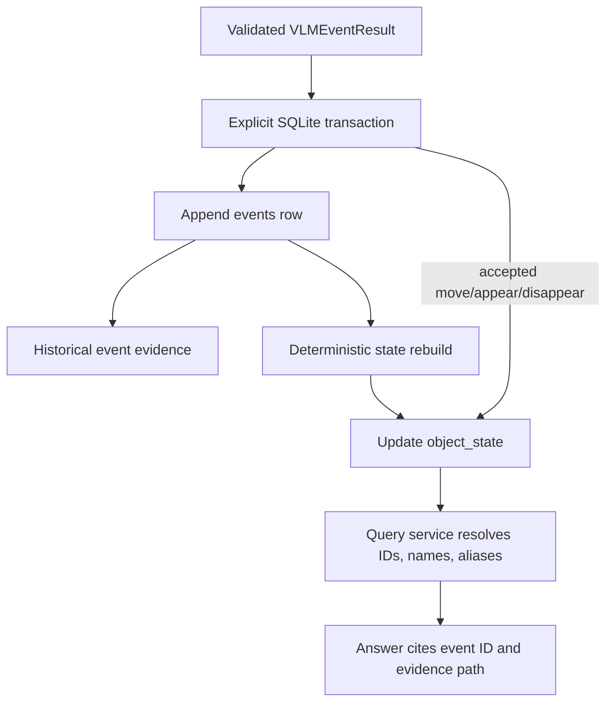

# LocalRecall architecture

## Data flow

Manual image-pair analysis is the supported vertical slice. Browser streaming is ingress-only while automatic detection remains disabled; it must converge on the same `analyze_pair` pipeline after the motion gate is implemented and verified.

```mermaid
flowchart LR
    L[Laptop browser: BEFORE and AFTER uploads/snapshots] -->|SSH local forward| G[Gradio Blocks on GB10 localhost]
    G --> F[LocalRecallFacade]
    F --> C[Validate RGB inputs and build labeled composite]
    C --> V[VLMClient]
    V -->|loopback OpenAI-compatible API| Q[Qwen3.8-27B-NVFP4 via vLLM container]
    Q --> J[Parse JSON, validate IDs, one repair attempt]
    J --> P[Confidence review policy]
    P --> D[SQLite event log and current object state]
    D --> A[Deterministic Ask answers with event evidence]
```

## Event processing states

The automatic motion state machine is planned but not enabled in the current app. Manual image-pair analysis bypasses motion states and uses the same event analyzer and persistence rules.

## Database flow

SQLite uses WAL mode and foreign keys. `events` is the history; `object_state` is a rebuildable projection. Accepted moves and appearances update a zone. Disappearances set state to `outside_view`; `no_change` and `uncertain` do not change state. Corrections rebuild the projection.

## Privacy boundaries

- Laptop browser frames cross only the private laptop-to-GB10 LAN/SSH path; they do cross that network.
- Model requests go to a loopback endpoint. No cloud inference API is part of the app.
- Browser ingress is held in a bounded RAM ring. No video writer exists in the default path.
- Event/reference evidence is stored on disk. Gradio may also cache transient images under `GRADIO_TEMP_DIR`; the janitor applies a 24-hour retention and 2 GiB cap, Delete All Memory clears it, and orderly backend shutdown clears it.
